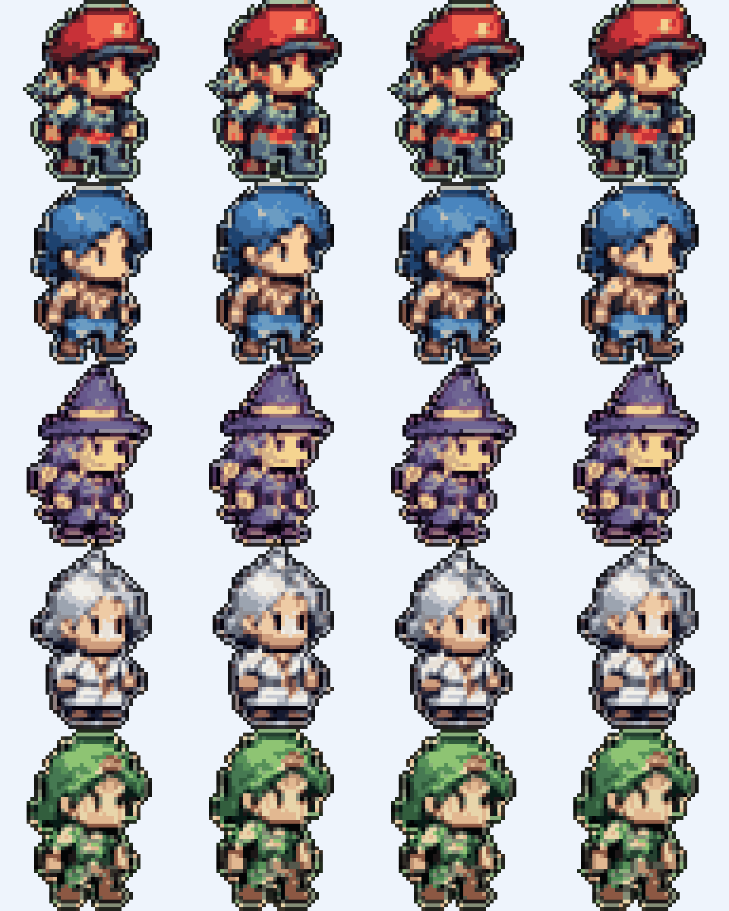

# RPG型Todoアプリ 要件定義書

- 版数: v0.7
- 更新日: 2026-10-13
- 対象: iPhone（iOS ネイティブアプリ＋ホーム画面ウィジェット）
- 元資料: 「RPG型Todoアプリ 要件定義・実装指示書」（ChatGPT との事前相談内容）、画面イメージ（[docs/images/concept-v1.png](images/concept-v1.png)）

本書は元資料を開発着手できる粒度に落とし込んだものです。v0.3 で主要な確認事項はすべて確定しました（12章）。

### 改訂履歴

| 版 | 日付 | 内容 |
|---|---|---|
| v0.1 | 2026-10-13 | 初版ドラフト |
| v0.2 | 2026-10-13 | 確認事項への回答と画面イメージを反映。対応OSを iOS 27 に変更、繰り返しTodoを MVP に追加、ダークモード対応、特別キャラ「スーパースター」追加、ドット絵の制作方針（GPT 画像生成）を追加、タブ構成・リスト並び順・ウィジェット表示を画面イメージに合わせて変更 |
| v0.3 | 2026-10-13 | スーパースターを「100% 達成時に毎回加わる7人目」に確定、左上「☰」をキャラクター図鑑に割り当て、ドット絵を**エディタを使わず全自動で整形する**方針に変更（スクリプト試作済み）、開発環境（Mac・Xcode）確定 |
| v0.4 | 2026-10-13 | 勇者のデザイン変更を確定。スーパースターのデザインを確定（黒髪ツインテールのアイドル風）、本素材 v1 を取り込み。スプライトを **48×48px** に変更（GPT 生成画像の本来のドット数を保つため）。歩行4ポーズを GPT で直接生成する方式を追加 |
| v0.7 | 2026-10-14 | **キャラは歩かない静止画に変更**（歩行アニメーション廃止）。そのぶん**キャラ数を大幅に増やし**、達成率ごとに加わる仲間を**日ごとのランダム抽選**にする（達成率の刻みは従来どおり）。図鑑をコレクション要素として強化 |
| v0.6 | 2026-10-13 | 最低対応OSを **iOS 26.0** に変更（開発Macの Xcode が 26.5 で iOS 27 SDK がないため。使う機能は iOS 26 で揃っている）。iOS 27 の Xcode が使えるようになったら引き上げを検討 |
| v0.5 | 2026-10-13 | スーパースターを「100% 達成日に**まれに**出現するレアキャラ」に変更（通常の 100% は勇者＋仲間5人）。抽選ルールを追加 |

---

## 1. プロジェクト概要

### 1.1 コンセプト

「日常のタスクを、RPGの冒険に変えるTodoアプリ」

キャッチコピー（画面イメージより）: **「やることを、冒険に変える。」「小さな一歩が、大きな冒険につながる。」**

ユーザー自身が勇者となり、その日のTodoを達成するほど仲間が加わってパーティが大きくなる。達成率を数値で見せるだけでなく、**キャラクターが増える・隊列が伸びる**という視覚的な変化で達成感を伝える。

### 1.2 目的・成功指標

| 目的 | 指標（個人利用の目安） |
|---|---|
| 毎日自然に開きたくなる | 1日1回以上の起動 / ウィジェット確認 |
| Todo操作がストレスにならない | 追加: 2タップ＋入力、完了: 1タップ（ウィジェットからも1タップ） |
| 達成が楽しく感じられる | 節目到達時に必ず加入演出が出る |

### 1.3 基本方針

1. Todo管理部分は iOS 標準アプリ（リマインダー等）並みにシンプルにする。
2. ゲーム要素はドット絵キャラクターと冒険フィールドに集約し、操作UIと視覚的に分離する。
3. ウィジェットを主要機能として扱う。
4. 当日の進捗は日付変更でリセット、過去の履歴は保存する。
5. アカウント登録・クラウドサーバー不要。端末内で完結する MVP をまず完成させる。
6. 当面は個人利用だが、完成度次第で App Store 公開できるよう、**品質と権利面（素材の権利・プライバシー）は公開基準で作る**。

---

## 2. 対象プラットフォームと技術構成

### 2.1 技術構成

| 領域 | 採用技術 | 備考 |
|---|---|---|
| 言語 | Swift 6 | |
| UI | SwiftUI | |
| データ保存 | SwiftData | App Group 共有コンテナでウィジェットと共有 |
| ウィジェット | WidgetKit ＋ App Intents | インタラクティブウィジェットで完了操作 |
| カレンダー | EventKit | 読み取りのみ。予定は変更しない |
| 通知 | UserNotifications（ローカル通知） | サーバー不要 |
| ドット絵描画 | SwiftUI `Image` ＋ `.interpolation(.none)`（キャラは静止画1枚） | 演出（加入・100%）は SwiftUI の拡大・フェードで行う。SpriteKit は不要 |
| テスト | Swift Testing | |

### 2.2 動作環境

- 最低対応OS: **iOS 26.0**（当初は iOS 27 の想定だったが、開発Macの Xcode が 26.5 で iOS 27 SDK を使えないため変更。引き上げは Xcode 27 が使えるようになってから検討）
  - App Store 公開時に対象ユーザーを広げたい場合は iOS 26 まで下げることも可能。使う API は iOS 26 で揃っているため、下げる判断は公開前でよい。
- 対応端末: iPhone のみ（iPad 対応はスコープ外）
- 画面向き: 縦固定
- 外観: ライト／ダーク両対応（システム設定に追従。アプリ内で固定も可能）
- 開発環境: **Mac ＋ Xcode 26.5**（用意済み）。実機確認には Apple ID が必要（無料のパーソナルチームでも可能だが、7日ごとに再署名が必要。日常利用や公開には Apple Developer Program 加入を推奨）

> 補足: この作業環境（Linux）では iOS アプリのビルドはできません。そのため、達成率計算・パーティ判定・日付処理・繰り返し判定などの**ロジックは UI から独立した Swift Package（`RPGTodoCore`）として実装**し、Linux 上でもユニットテストを回せる構成にします。

### 2.3 プロジェクト構成（案）

```
Todo-application/
├── RPGTodo.xcodeproj
├── RPGTodo/                 # アプリ本体ターゲット
│   ├── App/                 # エントリポイント、DI
│   ├── Features/
│   │   ├── Home/            # 今日の冒険
│   │   ├── TodoEditor/      # 追加・編集（繰り返し設定含む）
│   │   ├── Calendar/        # カレンダー連携
│   │   ├── Records/         # 冒険の記録
│   │   ├── Encyclopedia/    # キャラクター図鑑（今日の目標を含む）
│   │   └── Settings/
│   ├── PartyField/          # キャラ表示・冒険フィールド・加入演出
│   └── Resources/           # Assets.xcassets（スプライト・背景）
├── RPGTodoWidget/           # ウィジェット拡張ターゲット
├── Packages/
│   └── RPGTodoCore/         # 純Swiftのドメインロジック（Linuxでテスト可能）
│       ├── Sources/RPGTodoCore/
│       │   ├── Progress/    # 達成率計算
│       │   ├── Party/       # 仲間加入ルール・スーパースター判定
│       │   ├── Recurrence/  # 繰り返しTodoの発生判定
│       │   ├── DayBoundary/ # 日付変更処理
│       │   └── Suggestion/  # 予定→Todo候補のテンプレート
│       └── Tests/
├── tools/
│   └── sprite-pipeline/     # GPT生成画像をスプライトに自動整形するスクリプト（7.3、試作済み）
├── art/
│   ├── source/              # GPT で生成した元画像
│   └── sprites/             # 整形済みスプライト（Assets に取り込む）
└── docs/
```

- アプリ本体とウィジェットは **App Group**（例: `group.<bundle-id>.shared`）で SwiftData のストアを共有する。
- 書き込み後は `WidgetCenter.shared.reloadAllTimelines()` でウィジェット更新を要求する。
- 日付変更処理（繰り返しTodoの生成を含む）は `RPGTodoCore` に置き、**アプリ・ウィジェットのどちらが先に起動しても同じ処理が走る**ようにする（アプリを開かずにウィジェットだけ見た日も正しく表示するため）。

---

## 3. 用語定義

| 用語 | 定義 |
|---|---|
| 対象日 | Todo が属する日（＝その日のリストに表示される日）。`date` で保持 |
| 当日の有効なTodo | 対象日が今日で、削除されていないTodo（繰り返しTodoから生成された今日の分を含む） |
| 繰り返しTodo | 毎日・平日・曜日指定などのルールに従い、該当日に自動で Todo を生成する設定 |
| 達成率 | 4.2 の式で算出する当日の割合（0〜100、整数） |
| 勇者 | ユーザー自身を表す主人公キャラクター。常に先頭に1人 |
| 仲間 | 達成率の節目で加入するキャラクター（最大5人） |
| スーパースター | 達成率100%の日に、まれに加わるレアキャラ（4.3.4） |
| 図鑑 | 出会ったキャラクターを記録・閲覧する画面（6.6） |
| 節目（マイルストーン） | 20 / 40 / 60 / 80 / 100% |
| 日付変更 | 端末のローカルタイムゾーンで 0:00 を跨いだ時点 |

---

## 4. 機能要件

機能IDの優先度: **P0 = MVP必須 / P1 = MVPに入れたい / P2 = 次期以降**

### 4.1 Todo管理

| ID | 機能 | 優先度 | 詳細 |
|---|---|---|---|
| T-01 | Todo追加 | P0 | タスク名のみ必須。画面右上の「＋」とリスト下の「新しいタスクを追加」ボタンのどちらからでも追加シートを開く |
| T-02 | Todo編集 | P0 | 行タップで編集シート |
| T-03 | Todo削除 | P0 | 左スワイプで削除。数秒間の「元に戻す」を表示（P1） |
| T-04 | 完了／未完了切替 | P0 | 行左のチェック円をタップ。完了時は青い塗りつぶしチェック＋軽い触覚フィードバック |
| T-05 | 対象日・時刻設定 | P0 | 対象日の既定値は今日。時刻は任意 |
| T-06 | カテゴリ設定 | P0 | 仕事 / プライベート / 健康 / その他（既定: その他） |
| T-07 | 今日のタスク一覧 | P0 | **時刻の昇順**（時刻なしは末尾に作成順）。完了しても行の位置は動かさない（画面イメージ準拠。完了のたびに行が飛ばないようにする） |
| T-08 | 未完了タスクの確認 | P0 | 過去日の未完了Todoを一覧表示し、手動で「今日に移す」（4.1.2） |
| T-09 | 過去日の履歴確認 | P0 | 冒険の記録画面から日付を選び、その日のTodoと達成率を閲覧 |
| T-10 | 繰り返しTodo | **P0** | 4.1.1 参照 |
| T-11 | 通知 | P1 | 時刻を設定したTodoに対し、指定時刻にローカル通知 |
| T-12 | リストメニュー（「…」） | P1 | 「今日のタスク」カード右上の「…」から: 完了済みを隠す / 未完了タスクを見る / カテゴリで絞り込み |

#### 4.1.1 繰り返しTodo（MVP に含める）

| 項目 | 仕様 |
|---|---|
| 設定場所 | Todo 追加・編集シートの「繰り返し」項目（既定: なし） |
| ルール | なし / 毎日 / 平日（月〜金） / 曜日指定（複数選択可）。P2 で「毎月◯日」「◯日ごと」 |
| 生成タイミング | その日になったとき（日付変更処理・アプリ起動・ウィジェット更新のいずれか早いもの）に、該当する繰り返し設定から当日の Todo を1件生成する |
| 重複防止 | 「繰り返し設定ID＋対象日」で一意。同じ日に二重生成しない |
| 当日分の削除 | 「この日だけ削除」/「繰り返しを終了」を選択。この日だけ削除した場合、その日は再生成しない |
| 編集 | 「この日だけ変更」/「今後すべて変更」を選択 |
| 未完了のまま翌日になった場合 | 繰り返しTodoは翌日分が自動で作られるため「今日に移す」の対象外 |
| アプリを開かなかった日 | 次回起動時に、その間の日の分も生成して確定する（＝未完了として記録される）。長期で使わない場合のため、繰り返し設定ごとに「一時停止」を用意する（P1） |
| 表示 | 行に小さな繰り返しアイコン（SF Symbols `repeat`）を表示 |

#### 4.1.2 過去日の Todo の扱い（決定）

- 未完了Todoは**自動で翌日に繰り越さない**（繰り越すと過去の達成率が変わり、履歴の意味がなくなるため）。
- 日付変更後、過去日のTodoは**読み取り専用**とし、完了状態は変更できない。
- 「今日に移す」を実行すると、今日の日付で**新しいTodoとして複製**し、元のTodoには「繰越済」の印を付ける（元の日の達成率は変わらない）。

### 4.2 達成率の計算

```
達成率 = floor(完了済みTodo数 ÷ 当日の有効なTodo総数 × 100)
```

| ID | 要件 |
|---|---|
| P-01 | 計算は `RPGTodoCore` の単一関数で行い、アプリ・ウィジェット・履歴のすべてがこれを使う |
| P-02 | 端数は**切り捨て**（例: 3件中2件 = 66%）。100% は全件完了時のみ |
| P-03 | Todo 0件の場合は数値を出さず「今日の冒険は準備中」状態とする（パーティは勇者のみ） |
| P-04 | Todo の追加・削除・完了切替・対象日変更のたびに再計算する |

### 4.3 RPGパーティシステム

#### 4.3.1 加入ルール

```
仲間の人数 = floor(達成率 ÷ 20)    （0〜5人）
```

| 達成率 | パーティ |
|---|---|
| 0〜19% | 勇者のみ |
| 20〜39% | 勇者＋仲間1人 |
| 40〜59% | 勇者＋仲間2人 |
| 60〜79% | 勇者＋仲間3人 |
| 80〜99% | 勇者＋仲間4人 |
| 100% | 勇者＋仲間5人（全員集合、計6人）。**まれにスーパースターが加わり7人**（4.3.4） |

- Todo件数が少ない日は節目を一度に複数超えることがある（例: 2件中1件で 50% → 2人加入）。その場合は加入演出を順番に再生する。
- チェックを外して達成率が下がった場合は、即座に人数も減らす（減少時は演出なしでフェードアウト）。

#### 4.3.1a 誰が加わるか（ランダム・v0.7 で追加）

人数の刻み（20%ごと）は従来どおり。**加わるキャラクターは、日ごとに仲間プールからランダムに決まる。**

| 項目 | 仕様 |
|---|---|
| 抽選のタイミング | その日に初めてパーティ情報が必要になったとき（最初の完了操作、アプリ起動、ウィジェット表示のいずれか早いもの）に、**5体を並び順つきで一度にまとめて抽選**する |
| 抽選元 | 仲間プール（4.3.3）の通常キャラ。勇者とスーパースターは含まない |
| 重複 | 同じ日に同じキャラは出ない（5体は全員別） |
| 保存 | 抽選結果を `DailyProgress.companionLineup`（5体のID）に保存する。n人目の加入ではn番目のキャラが登場する |
| 安定性 | その日のうちは、チェックを付け外ししても**顔ぶれも順番も変わらない**。アプリとウィジェットも同じ結果を参照する（先に動いた方が抽選して保存。二重に抽選しない） |
| 日付変更 | 新しい日に引き直す。過去の日の顔ぶれは履歴として残る（記録画面で見られる） |
| プールが5体のとき | 顔ぶれは変わらず、並び順だけランダム（プールが5体を超えると顔ぶれも変わる） |
| 未発見キャラの優先（P1） | まだ図鑑に載っていないキャラの当選しやすさを2倍にして、コレクションを進めやすくする（倍率は設定値として1か所で管理） |

#### 4.3.2 加入演出の再生条件（決定・当面の仕様）

- 各節目の加入演出は **1日1回のみ**。誰が加わるかは4.3.1a の抽選結果で決まっていて、演出を何度見ても変わらない。その日に一度到達した節目は `unlockedMilestones` に記録し、チェックの付け外しを繰り返しても再生しない。
- 人数表示自体は常に現在の達成率に連動する。
- 100% 到達時は、5人目の加入演出 →「全員集合！」の特別演出を再生する。スーパースターの抽選に当たった場合は、続けて登場演出を再生する。
- 運用してみて物足りなければ見直す（ご回答「とりあえず」より）。

#### 4.3.3 キャラクター（仲間プール）

キャラクターは**立ち姿の静止画1枚**で表現する（歩行アニメーションは行わない。v0.7）。歩かないぶん、キャラの種類を増やして楽しさを出す。

**種類の目標: 通常の仲間 12 体 ＋ 勇者 ＋ スーパースター（計14体）**。MVP は現行素材で出せる分から始め、素材ができ次第プールに追加する。プールが5体を超えた時点から「日ごとに顔ぶれが変わる」楽しさが出るので、早めに増やす。

| 区分 | 職業 | 特徴 | 素材 |
|---|---|---|---|
| 主人公 | 勇者（あなた） | 赤いハチマキ・青緑のチュニック | ✅ |
| 仲間 | 剣士 | 青い髪・背中に大剣 | ✅ |
| 仲間 | 魔法使い | 紫のとんがり帽子 | ✅ |
| 仲間 | 僧侶 | 銀髪・白い法衣 | ✅ |
| 仲間 | 盗賊 | 緑の頭巾 | ✅ |
| 仲間 | 騎士 | 銀の兜・大きな盾 | ✅ |
| 仲間（追加候補） | 弓使い | 橙のポニーテール・短弓 | 未作成 |
| 仲間（追加候補） | 武闘家 | 道着・ハチマキ・素手 | 未作成 |
| 仲間（追加候補） | 踊り子 | ベール・ひらひらした衣装 | 未作成 |
| 仲間（追加候補） | 錬金術師 | ゴーグル・フラスコ | 未作成 |
| 仲間（追加候補） | 忍者 | 黒装束・マフラー | 未作成 |
| 仲間（追加候補） | 吟遊詩人 | 羽根付き帽子・リュート | 未作成 |
| 仲間（追加候補） | 海賊 | 眼帯・三角帽子 | 未作成 |
| レア | スーパースター | 黒髪ツインテールのアイドル風（4.3.4） | ✅ |

- 追加候補は仮。好きな職業に入れ替えてよい（13章で確認）。
- キャラクターはデータ（キャラID・表示名・スプライト名・紹介文・レア度）で定義し、**コードを変えずにキャラを追加できる構造**にする。「加入順」は持たない（順番は日ごとの抽選で決まるため）。
- 全キャラの当選しやすさは MVP では同じ。レア度による重み付けは次期。

#### 4.3.4 スーパースター（決定: レアキャラ）

- **達成率100%の日に、まれに出現するレアキャラ**。通常の100%は勇者＋仲間5人で、スーパースターは出ない。
- 抽選ルール（数値は仮。設定値として1か所で管理し、運用しながら調整する）:

| 項目 | 仕様 |
|---|---|
| 抽選のタイミング | その日に**初めて**100%に到達したときに1回だけ |
| 出現確率 | **10%**（仮） |
| 再抽選 | しない。チェックの付け外しで何度100%にしても、その日の結果は変わらない |
| 救済（天井） | 100%の日が**10回連続で外れ**たら、次の100%で必ず出現（仮） |
| 出現した日 | その日は100%の間パーティにいる。1件外すと離脱し、再び100%になると演出なしで戻る |

- 登場時は空から星が降ってくる演出のあと、隊列の最後尾に加わる。
- 見た目は**黒髪ツインテール、ピンク・白・ミントのアイドル風ドレスとリボン**（v1 素材で確定）。ほかの仲間（冒険者風）と違う華やかさで特別感を出す。キラキラの演出は別素材。
- 100% から1件でもチェックを外すと離脱する（加入演出は1日1回のルールに従い、再度100%にしても再生しない）。
- 記録カレンダーでは、スーパースターが登場した日に星マークを付ける。
- 図鑑では、一度も出会っていない間はシルエット＋「？？？」と「100%の日に、まれに…」というヒントだけを表示する。

#### 4.3.5 冒険フィールド

| ID | 要件 |
|---|---|
| F-01 | ホーム画面最下部（タブバーの直上）に、勇者を先頭にしてパーティが**横一列に並んで立つ**フィールドを表示する。キャラは静止画 |
| F-02 | 背景はレトロRPG風の草原と森（画面イメージ準拠）。静止画 |
| F-03 | 最大7体（勇者＋仲間5人＋スーパースター）が画面幅に収まる倍率の整数倍で表示する。重なる場合は後ろのキャラが前のキャラに少し隠れる並べ方にする |
| F-04 | 常時動くアニメーションは行わない（バッテリー節約）。動くのは加入・100%などの短い演出のときだけ |
| F-05 | 加入演出: 新しい仲間が上からぽんと弾んで現れ、隊列の最後尾に並ぶ（SwiftUI の移動・拡大・フェード）。「視差効果を減らす」がオンの場合はフェードのみ |
| F-06 | 100% のとき、フィールド上に「全員集合！」バナーを数秒表示する（スーパースターが出た日は星が降る演出を足す） |
| F-07 | フィールドをタップすると図鑑（6.6）を開く |
| F-08 | ダークモード時は夕暮れ／夜の配色の背景に切り替える（P1。MVP では昼の背景を暗めに補正して対応） |

### 4.4 カレンダー連携

| ID | 要件 | 優先度 |
|---|---|---|
| C-01 | 初回利用時に EventKit でカレンダーのフルアクセス許可を求める（読み取りに必要） | P0 |
| C-02 | 今日・明日の予定を取得し、開始・終了時刻とタイトルを表示 | P0 |
| C-03 | ホーム画面の「カレンダーからの予定」カードに次の予定を1件表示し、タップで「カレンダー」タブへ | P0 |
| C-04 | 予定ごとにTodo候補を生成し、ユーザーが採用／除外を選べる | P0 |
| C-05 | 候補は編集してから採用できる | P1 |
| C-06 | 元のカレンダー予定は一切変更しない（読み取り専用） | P0 |
| C-07 | 同じ予定から候補・Todoを重複生成しない（4.4.2） | P0 |
| C-08 | 予定の変更・削除を検知し、紐づくTodoに「予定が変更されました」を表示（Todo自体は自動削除しない） | P1 |
| C-09 | 設定画面から連携を解除できる（OS側の権限取り消しへの案内も表示） | P0 |
| C-10 | 外部サービス（Google Calendar API 等）との直接連携 | P2（iOS の「カレンダー」に Google アカウントを追加すれば EventKit 経由で取得できるため当面不要） |

#### 4.4.1 候補生成方式（決定: MVP は端末内テンプレート）

| キーワード例 | 候補 |
|---|---|
| 会議・定例・MTG | 「{予定名}の資料を確認する」 |
| 訪問・商談・打ち合わせ | 「{予定名}の提案資料を準備する」 |
| レビュー | 「{予定名}の修正箇所を確認する」 |
| 該当なし | 「{予定名}の準備をする」 |

- 候補の時刻は既定で予定開始の30分前（ユーザーが変更可）。
- 外部AIへの送信は行わない。
- 次期: iOS の端末内生成AI（Foundation Models フレームワーク。Apple Intelligence 対応端末のみ）による候補提案。端末外にデータを出さずに実現できる。非対応端末ではテンプレート方式にフォールバック。

#### 4.4.2 重複防止

- 繰り返し予定は同一の識別子を共有するため、**「予定の識別子＋その回の開始日時」** を重複判定キーとし、Todo の `calendarEventKey` に保存する。
- 採用済み・除外済みの予定は候補一覧に再表示しない（除外済みは「除外した予定を表示」で復帰可能）。

### 4.5 ウィジェット

| ID | 要件 | 優先度 |
|---|---|---|
| W-01 | 小・中・大の3サイズ（表示内容は 6.7 参照） | P0 |
| W-02 | 達成率・完了数／総数・進捗バー・パーティ（静止画）を表示 | P0 |
| W-03 | 中・大サイズでは今日のTodoを表示。完了済みは青チェック＋取り消し線＋グレー文字 | P0 |
| W-04 | Todo 行のチェックをタップすると**アプリを開かずに完了切替**（App Intents） | **P0**（iOS 26 でも対応しているため MVP に含める） |
| W-05 | チェック以外の場所をタップするとアプリのホーム画面を開く | P0 |
| W-06 | アプリでの変更後に更新を要求。加えて毎日 0:00 のタイムラインエントリで新しい日の表示（繰り返しTodo生成済み）に切り替える | P0 |
| W-07 | キャラはアプリ内と同じ静止画を使う | ― |
| W-08 | ロック画面ウィジェット（達成率の円形ゲージ） | P2 |

> 注意: ウィジェットの更新タイミングは OS が制御するため、常時リアルタイムでの一致は保証できない。アプリやウィジェット上の操作直後には反映されるが、それ以外は数分程度の遅れがあり得る。

### 4.6 冒険の記録（履歴）

| ID | 要件 | 優先度 |
|---|---|---|
| H-01 | 日別の達成率・完了数／総数・加入した仲間の人数をカレンダー形式で表示 | P0 |
| H-02 | 過去日を選んでその日のTodoとパーティを閲覧 | P0 |
| H-03 | 連続達成日数（ストリーク） | P1 |
| H-04 | 週次・月次の平均達成率 | P1 |
| H-05 | 簡易グラフ（直近7日／30日の達成率推移） | P2 |

**連続達成日数の定義** — 「達成率100%の日」が連続した日数。Todo 0件の日は連続を途切れさせず、カウントもしない（休日扱い）。今日がまだ100%でない場合は昨日までの連続日数を表示する。

### 4.7 設定

| ID | 項目 | 優先度 |
|---|---|---|
| S-01 | カレンダー連携のオン／オフ、対象カレンダーの選択 | P0（選択は P1） |
| S-02 | 通知のオン／オフ | P1 |
| S-03 | 外観（システムに従う／ライト／ダーク） | P0 |
| S-04 | 繰り返しTodoの管理（一覧・一時停止・削除） | P0 |
| S-05 | データ管理: JSON 形式でのエクスポート／インポート、全データ削除 | P1（全削除は P0） |
| S-06 | アプリ情報（バージョン、ライセンス、素材クレジット） | P0 |

### 4.8 日付変更処理

| ID | 要件 |
|---|---|
| D-01 | 日付判定は端末のローカルタイムゾーン・**0:00 区切り**（決定） |
| D-02 | アプリが前面に戻ったとき、起動中に 0:00 を跨いだとき（`significantTimeChange` 通知）、ウィジェットのタイムライン生成時に日付変更を判定 |
| D-03 | 日付変更時の処理順: ①前日までの `DailyProgress` を確定 → ②ストリーク更新 → ③今日の繰り返しTodoを生成 → ④今日のパーティを勇者のみから開始 |
| D-04 | 数日ぶりに起動した場合も、間の日について ①〜③ を日付順に実行し、履歴を欠損させない |
| D-05 | 処理は冪等にする（何度実行しても結果が同じ。アプリとウィジェットで同時に走っても二重生成しない） |

---

## 5. データモデル

**DailyProgress は Todo から再計算可能な派生データ**であり、履歴表示の高速化と日付確定のスナップショットとして保持する。

### 5.1 Todo

| 項目 | 型 | 必須 | 説明 |
|---|---|---|---|
| id | UUID | ○ | |
| title | String | ○ | 1〜100文字 |
| date | Date（日付のみ） | ○ | 対象日 |
| time | Date? | | 時刻 |
| category | Enum | ○ | work / private / health / other |
| isCompleted | Bool | ○ | |
| completedAt | Date? | | |
| notificationEnabled | Bool | ○ | 既定 false |
| recurrenceId | UUID? | | 繰り返し設定から生成された場合の元ID |
| calendarEventKey | String? | | 予定識別子＋開始日時（4.4.2） |
| carriedOverTo | UUID? | | 「今日に移す」で作られた複製先 |
| createdAt / updatedAt | Date | ○ | |

> 元資料の `dueDate`（期限）は `date`（対象日）と役割が重なるため `date` に統合。締切管理は P2。

### 5.2 Recurrence（繰り返し設定）※新規

| 項目 | 型 | 説明 |
|---|---|---|
| id | UUID | |
| title / time / category / notificationEnabled | | 生成する Todo の雛形 |
| rule | Enum | daily / weekdays / weekly(曜日の集合) |
| startDate | Date | この日以降に生成 |
| endDate | Date? | 繰り返し終了日 |
| isPaused | Bool | 一時停止中は生成しない |
| skippedDates | [Date] | 「この日だけ削除」した日 |
| lastGeneratedDate | Date? | 生成済みの最終日（冪等処理用） |

### 5.3 DailyProgress（日次スナップショット）

| 項目 | 型 | 説明 |
|---|---|---|
| date | Date（一意キー） | |
| totalTasks / completedTasks | Int | |
| completionRate | Int? | Todo 0件なら nil |
| partyMemberCount | Int | 仲間の人数（勇者を含まない、0〜5。スーパースターは数えない） |
| unlockedMilestones | [Int] | その日に到達した節目（演出再生済み管理を兼ねる） |
| companionLineup | [String] | その日に抽選された仲間5体のID（加入する順。4.3.1a）。未抽選なら空 |
| superstarRolled | Bool | その日の抽選が済んだか（再抽選防止） |
| superstarAppeared | Bool | その日の抽選に当たったか |
| streakCount | Int | その日時点の連続達成日数（P1） |
| isFinalized | Bool | 日付変更で確定済みか |

> スーパースターの救済用カウント（連続で外れた回数）は Settings に `superstarMissStreak` として保持する。

> 元資料の `PartyState` は、日付と節目情報が DailyProgress と重複するため統合。「現在のパーティ」は今日の DailyProgress から導出する。

### 5.4 CalendarSuggestionRecord

| 項目 | 型 | 説明 |
|---|---|---|
| calendarEventKey | String（一意キー） | |
| eventTitle / startAt / endAt | | 変更検知用 |
| status | Enum | adopted / dismissed |
| lastSyncedAt | Date | |

### 5.5 Settings

`UserDefaults`（App Group 共有）に保存: `appearance`, `notificationsEnabled`, `calendarAccessEnabled`, `selectedCalendarIds`。

### 5.6 Character（静的定義・JSON）

`id`, `jobName`, `spriteName`（静止画1枚）, `kind`（hero / companion / rare）, `profile`（図鑑の紹介文）, `hint`（未発見時のヒント文）

### 5.7 CharacterRecord（図鑑の記録）※新規

| 項目 | 型 | 説明 |
|---|---|---|
| characterId | String（一意キー） | |
| firstJoinedAt | Date? | 初めて仲間になった日（nil なら未発見） |
| joinCount | Int | 仲間になった日数（同じ日に何度加入しても1回） |

---

## 6. 画面要件

画面イメージ（[docs/images/concept-v1.png](images/concept-v1.png)）を正とする。左右の宣伝文（「やることを、冒険に変える。」や機能紹介）はアプリ画面ではなく、App Store 掲載用のプロモーション素材として扱う。

### 6.1 画面一覧・遷移

タブバーは **4 タブ**（画面イメージ準拠）: **ホーム / カレンダー / 記録 / 設定**

```
[ホーム] ─┬─ 右上(+) / 「新しいタスクを追加」 ─→ [Todo追加シート]
          ├─ Todo行タップ ─────────────────→ [Todo編集シート]
          ├─ 「カレンダーからの予定」カード ─→ [カレンダー]タブ
          ├─ 左上(☰) ──────────────────────→ [キャラクター図鑑]
          └─ フィールドをタップ ───────────→ [キャラクター図鑑]
[カレンダー] ── 予定一覧＋Todo候補
[記録] ──── 日付タップ ──────────────────→ [日別詳細]
[設定] ──── 繰り返しTodoの管理 など
```

> 画面イメージ左上の「☰」は**キャラクター図鑑**を開くボタンにする（決定）。アイコンはメニューと誤解されないよう、本のアイコン（SF Symbols `book.closed`）に変更する案とする。絞り込み等は「今日のタスク」カードの「…」メニューに集約する。

### 6.2 ホーム画面（今日の冒険）

```
┌────────────────────────────┐
│ (📖)                     (+)   │  ← 左上: 図鑑 / 右上: 追加ボタン
│ 4月26日(土)            🏰       │
│ 今日の冒険          ドット絵の  │  ← 大見出し＋右側に城と山の
│ やることをこなして、 背景イラスト│     ドット絵ヘッダー
│ 仲間と一緒に進もう。            │
│  ◯60%   3 / 5                  │  ← 円形ゲージ＋完了数
│         タスク完了              │
│ ┌──────────────────────────┐ │
│ │ 今日のタスク            …  │ │
│ │ ● メールの返信       09:00 │ │  ← 完了: 青い塗りつぶしチェック
│ │ ● 会議資料の確認     10:00 │ │
│ │ ○ 企画書の作成       13:00 │ │  ← 時刻順。完了しても位置は不変
│ │ ○ ジムに行く         18:00 │ │
│ │ ○ 夕食の準備         19:30 │ │
│ │ ┌──────────────────────┐ │ │
│ │ │📅 カレンダーからの予定  ＞│ │ │  ← 次の予定1件
│ │ │   10:00 定例会議         │ │ │
│ │ └──────────────────────┘ │ │
│ │ [  ＋ 新しいタスクを追加  ] │ │  ← 青いボタン
│ └──────────────────────────┘ │
│ 🌳 勇者 ◯◯ ◯◯ ◯◯ ◯◯ ◯◯ │  ← 冒険フィールド（顔ぶれは日替わり）
├────────────────────────────┤
│ ホーム  カレンダー  記録  設定 │  ← タブバー
└────────────────────────────┘
```

| 要素 | 仕様 |
|---|---|
| ヘッダー | 日付・「今日の冒険」・サブコピー。右側に城と山のドット絵イラスト（静止画、装飾） |
| 進捗 | 円形ゲージ（青）＋「3 / 5 タスク完了」。0件時は「今日の冒険は準備中」 |
| タスクカード | 白い角丸カード。完了済みは青い塗りつぶしチェック（アプリ内は取り消し線なし、ウィジェットは取り消し線あり。画面イメージ準拠） |
| 予定カード | 淡い青背景の角丸カード。カレンダー未連携時は「カレンダーと連携する」導線を表示 |
| リストが長い場合 | タスクカード部分のみスクロールし、フィールドとタブバーは固定 |
| 加入演出 | フィールド上で再生し、Todo 操作を妨げない。100% 時はフィールド上に「全員集合！」バナー（2〜3秒で自動的に消える） |

### 6.3 Todo追加・編集シート

- ハーフシート表示。開いた時点でタスク名にフォーカスし、キーボードを表示。
- 項目: タスク名（必須）/ 対象日（既定: 今日）/ 時刻（既定: オフ）/ カテゴリ / **繰り返し（既定: なし）** / 通知（時刻設定時のみ表示）
- キーボードの「完了」でそのまま保存（最短: ＋ → 入力 → 完了）。
- 編集時のみシート下部に「削除」。繰り返しTodoの場合は「この日だけ／今後すべて」を確認。

### 6.4 カレンダータブ

- 今日・明日の予定を時刻順にリスト表示し、各予定の下にTodo候補を表示。
- 各候補に「追加」「除外」ボタン。「すべて追加」ボタンも用意。
- 未許可時は説明文と「カレンダーへのアクセスを許可」ボタン。拒否済みの場合は設定アプリへの案内。

### 6.5 記録タブ（冒険の記録）

- 上部: 連続達成日数・今週の平均達成率のサマリーカード
- 中部: 月カレンダー（各日に達成率の色: 100%=緑、1〜99%=青の濃淡、0件=グレー。スーパースター登場日は星マーク）
- 日付タップ: その日のTodo一覧・達成率・その日のパーティ（静止画）

### 6.6 キャラクター図鑑

画面イメージ右下の「仲間たち」「今日の目標」をもとに、図鑑として実装する。左上のボタンまたはフィールドのタップでシート表示。

| 区画 | 内容 | 優先度 |
|---|---|---|
| 今日の目標 | 「達成率 100% で、全員集合！」。あと何件で次の仲間が加入するかを表示（例: 「あと1件で新しい仲間が加わる」（誰かはそのときまでのお楽しみ）） | P0 |
| 発見数 | 図鑑の上部に「発見 7 / 14」のように集めた数を表示。全員そろうとコンプリート表示 | P0 |
| 仲間たち（一覧） | 全キャラのカードをグリッド表示。今日パーティにいるキャラにはバッジ | P0 |
| 未発見の表示 | 一度も仲間になっていないキャラは黒いシルエット＋「？？？」。**ヒントは「いつか仲間になるかも」程度**（出現はランダムで条件がないため、スーパースターだけ「100%の日に、まれに…」） | P0 |
| 詳細 | カードをタップすると、大きな表示（整数倍の静止画）・職業名・紹介文・初めて仲間になった日・仲間になった日数 | P0 |
| 今後の拡張 | 新キャラの追加、レア度の導入、キャラの入れ替え。図鑑は追加キャラを受け入れる前提の作りにする | P2 |

- 図鑑の記録は日付が変わっても消えない（5.7 CharacterRecord）。

### 6.7 ウィジェット

| サイズ | 表示内容 |
|---|---|
| 小 | 「今日の冒険」、達成率（大きな数字）、完了数／総数、パーティ（最大7体を縮小表示） |
| 中（画面イメージ準拠） | 上: 「今日の冒険」・達成率・完了数・進捗バー / 中: Todo 最大4件（完了は取り消し線） / 下: フィールド背景つきパーティ。背景に城のドット絵 |
| 大 | 中サイズのレイアウトで Todo を最大8件表示 |

- 表示する Todo は時刻順。件数を超える場合は未完了を優先し、「ほか n 件」と表示。
- Todo 0件時は「今日の冒険は準備中」＋勇者のみ。
- ダークモード時はカード部分を暗色に、背景イラストは暗めに補正。

---

## 7. デザイン要件

### 7.1 UI

| 項目 | 指定 |
|---|---|
| 基調色 | 白（ダーク時はシステム背景色）。画面全体はごく淡い青みの白（画面イメージ準拠） |
| メインカラー | 青（ボタン・進捗ゲージ・**完了チェック**） |
| 緑 | 達成率100%の表示、記録カレンダーの100%日、加入演出のアクセント |
| カテゴリ色 | 仕事=青、プライベート=紫、健康=緑、その他=グレー（小ラベルのみで使用） |
| カード | 角丸 16pt 前後、控えめなシャドウ |
| フォント | システムフォント。ダイナミックタイプ対応 |
| アイコン | SF Symbols |

> 元資料では「緑をタスク完了のアクセント」としていましたが、画面イメージに合わせて**完了チェックは青**（当面の決定。色は定数1か所で管理し、後から簡単に変えられるようにする）、緑は「100%達成」の強調に使います。

### 7.2 キャラクター・ドット絵の仕様

| 項目 | 指定 |
|---|---|
| スプライトサイズ | キャンバス **48×48px**、キャラ本体は縦 38〜44 ドット程度（v0.4 で 32px から変更。GPT 生成画像は縦40ドット前後で描かれるため、32px に縮小すると顔などがつぶれることを確認した）。表示時は整数倍に拡大 |
| 頭身 | 2〜2.5頭身のデフォルメ |
| 向き | MVP は既存素材に合わせて右向き。歩かないので正面向きに統一する案もあり（13章で確認） |
| ポーズ | **立ち姿の静止画1枚**（歩行フレームなし） |
| 色数 | 1体あたり輪郭色を含め 16色以内。輪郭は濃色ではっきり描く |
| 背景 | 透過 PNG |
| 拡大描画 | ニアレストネイバー（補間なし） |
| ファイル名規約 | `{キャラID}.png`（例: `swordsman.png`） |
| 背景素材 | フィールド（横にループできるタイル状の草原・森）、ホームヘッダー用の城と山、ウィジェット背景 |

### 7.3 ドット絵素材の制作方針（GPT 画像生成＋全自動整形）

**決定: ドット絵エディタは使わない。** ChatGPT で生成した画像を、スクリプトで全自動でスプライトに整形する。

画像生成の出力は「ドット絵風」の絵であり、そのままではスプライトとして使えない。手作業の代わりに次のように自動処理する。

| 課題 | 内容 | 自動での対策 |
|---|---|---|
| ピクセルが格子に揃っていない | 1ドットが正確な正方形になっていない | 元画像の「1ドットの大きさ」を自動検出し、本来のドット数の本物のピクセルに変換 |
| 色数が多い・にじみがある | 中間色やぼかしが入る | 16色に自動減色、背景とのにじみを除去 |
| 背景が透過でない | 単色背景が付く | 無地のマゼンタ背景で生成し、外周から自動で透過（キャラ内部の白は残す） |
| 小さいと背景に埋もれる | 輪郭が細い・薄い | 濃色の輪郭線を1px自動で付与 |
| キャラ間の統一感 | 1体ずつ生成すると絵柄がばらつく | 5〜7体を1枚に並べて生成し、自動で切り分ける（`--static`）。後から足すキャラは、既存キャラの画像を添付して「同じ絵柄・同じドットの細かさで」と頼む |

**ユーザーの作業（これだけ）**

1. [tools/sprite-pipeline/README.md](../tools/sprite-pipeline/README.md) のプロンプトを ChatGPT に貼り、キャラが横に並んだ立ち姿の画像を生成する（静止画なので、1枚に5〜7体まとめて頼める）
2. 生成画像をチャットに貼る
3. Claude Code が整形し、プレビュー（一覧画像）を返すので、OK か判断する
4. 気に入らないキャラだけ生成し直す

**試作結果（v0.3 時点）** — 画面イメージの「仲間たち」欄（小さな正面向きの画像）から5体を自動変換した結果。手作業なしで、アプリで使える水準になることを確認した。実際の素材は横向き・高解像度で生成するため、これより品質が上がる見込み。



**仕様の簡略化（手間を減らすため）**

- 向きは**1方向のみ**（図鑑・演出・ウィジェットすべてで共通）。
- 背景素材（フィールド・ヘッダーの城・ウィジェット背景）も同じスクリプトで縮小・減色のみ行う（透過は不要）。
- 自動整形で品質が足りない場合の代替案: Claude Code がドット単位のデータ（色番号の格子）を直接書いて PNG にする。手作業は不要だが、絵の描き込みは GPT 生成より素朴になる。

開発は**コードで作る仮スプライトで先行**し、本素材が揃い次第ファイル差し替えだけで反映する。

**権利面（App Store 公開の可能性があるため）**

- 生成時のプロンプトに既存作品名（ポケモン・ドラクエ・マリオ等）を入れない。
- 生成画像が既存キャラクターに似ていないか公開前に確認する。特に**「赤い帽子＋青い服」の勇者は有名キャラクターを連想させやすい**ため、帽子の形・配色・装備で差別化することを推奨。
- 生成に使ったプロンプトと元画像を `docs/assets-log/` に保存し、素材の出どころを記録する。
- 公開前に、その時点の OpenAI 利用規約で生成物の商用利用条件を確認する。

---

## 8. 非機能要件

| 分類 | 要件 |
|---|---|
| 性能 | Todo 完了タップから達成率・パーティ表示更新まで体感遅延なし（100ms 以内目標）。コールドスタートは 2秒以内 |
| バッテリー | 常時動くアニメーションはない（加入・100%などの短い演出のみ）。常時のバックグラウンド処理は行わない |
| オフライン | 全機能がネットワークなしで動作する |
| プライバシー | データはすべて端末内。カレンダー情報を外部に送信しない。トラッキングなし（App Store のプライバシー表示で「データの収集なし」にできる設計） |
| データ保全 | アプリ更新時にデータを失わない（SwiftData のスキーマ移行を考慮）。エクスポートでバックアップ可能（P1） |
| アクセシビリティ | VoiceOver で Todo 操作と達成率が読み上げられる（パーティは「勇者と仲間3人」のように説明文を付与）。視差効果を減らす設定に対応。ダークモードでもコントラスト比を確保 |
| ローカライズ | 日本語のみ（文字列は String Catalog で管理し、後から英語化できるようにする） |
| 品質 | ドメインロジック（達成率・加入人数・節目判定・日付変更・繰り返し生成・ストリーク・重複キー生成）はユニットテストで網羅 |

---

## 9. スコープ

### 9.1 MVP に含める

- Todo の追加・編集・削除・完了切替、対象日・時刻・カテゴリ
- **繰り返しTodo**（毎日・平日・曜日指定）
- 未完了タスクの確認と手動の「今日に移す」
- 達成率計算と 0件時の準備中表示
- パーティ人数の変化、加入演出（1日1回／節目）、100% 特別演出
- キャラの静止画（勇者＋仲間プール＋レアキャラのスーパースター）と冒険フィールド。仲間は日ごとのランダム抽選
- キャラクター図鑑（今日の目標・発見状況・紹介文）
- GPT 生成画像からの全自動スプライト整形
- 日付変更（0:00）でのリセットと履歴保存
- ウィジェット 小・中・大（表示＋**ウィジェットからの完了操作**）
- カレンダー予定の取得とテンプレート方式の候補生成・採用／除外・重複防止
- ライト／ダーク対応

### 9.2 MVP に含めない（次期以降）

- 締切日管理、サブタスク、月単位・◯日ごとの繰り返し
- 連続達成日数・週次月次集計（P1。MVP 完成後すぐに着手）
- 弓使い等の追加キャラ、キャラの入れ替え・装備・レベル
- 端末内 AI による候補提案
- 外部カレンダー API 連携、複数端末同期（iCloud 同期）
- ロック画面ウィジェット、Apple Watch、iPad、Android

---

## 10. 開発フェーズと完了条件

| フェーズ | 内容 | 完了条件 |
|---|---|---|
| Phase 0 | 開発環境・プロジェクト雛形 | Xcode プロジェクト・ウィジェット拡張・App Group・`RPGTodoCore` が作成され、空アプリが実機で起動する |
| Phase 1 | Todo 基本機能＋繰り返し | T-01〜T-10 が動作。達成率が操作に応じて正しく更新される。日付変更処理が動く。`RPGTodoCore` のテストが通る |
| Phase 2 | RPG システム＋素材 | 勇者・プールの仲間・スーパースターが静止画で表示され、達成率に応じて人数が変化。日ごとのランダム抽選（同じ日は顔ぶれ固定）・加入演出・100% 演出・スーパースターの抽選と登場演出が動作。GPT 生成画像を整形スクリプトで取り込み済み |
| Phase 3 | ウィジェット | 3 サイズが表示され、ウィジェットからの完了操作とアプリでの変更が相互に反映される。0:00 に新しい日に切り替わる |
| Phase 4 | カレンダー連携 | 許可取得 → 予定表示 → 候補の採用／除外。同じ予定から重複しない。連携解除できる |
| Phase 5 | 履歴・図鑑・仕上げ | 記録画面、キャラクター図鑑、連続達成日数・週次月次集計、ダーク時の背景、UI 調整 |

### 10.1 MVP 受け入れテスト

| # | 条件 | 確認方法 |
|---|---|---|
| 1 | Todo を追加・編集・削除できる | 追加 → 名称変更 → 削除が一覧に反映される |
| 2 | 完了で達成率が更新される | 5件中3件完了で「60% 3/5」と表示される |
| 3 | 達成率に応じてパーティ人数が変化 | 上記で仲間3人。1件チェックを外すと 40% で仲間2人 |
| 4 | オリジナルドット絵で表示 | 7キャラが補間なしのドット絵で表示される |
| 5 | 仲間加入の演出 | 20% 到達で演出が1回出る。外して付け直しても再生されない |
| 6 | 日付変更で新しい日のパーティ | 端末の日付を翌日にするとパーティが勇者のみになる |
| 7 | 過去の記録を保持 | 記録画面で前日の達成率・人数が確認できる |
| 8 | ウィジェットで確認・完了できる | ウィジェットのチェックで完了し、アプリを開くと反映されている |
| 9 | カレンダーから候補作成 | テスト予定「定例会議」から候補が出て、採用するとTodoになる。再度開いても重複しない |
| 10 | 操作が直感的 | Todo の追加が「＋→入力→完了」、完了が1タップで行える |
| 11 | 繰り返しTodo | 「毎日」設定のTodoが翌日も自動で表示される。同じ日に二重に出ない |
| 12 | スーパースター | 確率を一時的に100%に設定すると、全件完了で登場する。0%では登場しない。同じ日に付け外ししても抽選し直されない |
| 13 | ダークモード | 端末をダークモードにすると全画面・ウィジェットが読みやすい配色になる |
| 14 | 図鑑 | 左上のボタンで図鑑が開き、未発見キャラはシルエット、仲間になったキャラは紹介文が見られる |

---

## 11. リスクと対策

| リスク | 影響 | 対策 |
|---|---|---|
| iOS ビルドに Mac が必要 | 開発自体ができない | Mac ＋ Xcode を用意。ロジックは Linux でもテストできるよう分離 |
| ウィジェットの更新が OS 依存 | アプリとの表示ずれ | 変更時の更新要求＋0:00 のタイムラインエントリ。仕様として遅延を許容 |
| GPT 生成画像がスプライトとして整っていない | 素材制作が想定より手間取る | 整形を全自動化（試作で有効性を確認済み）。それでも品質不足のキャラは再生成、または Claude Code がドットデータを直接作成 |
| 歩かない静止画で動きが物足りない | 画面が地味に見える | キャラ数・加入演出・背景で補う。不満があれば、歩行アニメーションを後から追加できる構造（素材名を `{id}.png` と `{id}_walk_N.png` で分ける）にしておく |
| キャラ数が多く素材制作が大変 | Phase 2 の遅延 | 静止画1枚なので1回に5〜7体まとめて生成できる。素材は出来た分からプールに追加（プールは5体から動く） |
| 生成素材が既存キャラに似る | App Store 公開時の権利トラブル | 7.3 の権利面チェックを公開前に実施 |
| 繰り返しTodo＋未起動日の生成で 0% の日が増える | 履歴が暗くなる・意欲低下 | 繰り返しの一時停止機能。運用して不満があれば「未起動日は記録しない」設定を検討 |
| 予定タイトルだけでは作業内容が判断できない | 的外れな候補 | 候補は必ずユーザー確認後に採用。編集して採用可能に |
| 無料のパーソナルチームでの実機署名は7日で失効 | 日常利用が途切れる | 継続利用時は Apple Developer Program 加入を推奨 |

---

## 12. 決定事項一覧

| # | 項目 | 決定 |
|---|---|---|
| 1 | 対応OS | iOS 26 以上（v0.6 で 27 から変更） |
| 2 | 配布形態 | 当面は自分専用。完成度次第で App Store 公開を検討（公開基準の品質・権利で作る） |
| 3 | 仲間の人数 | 100% で勇者＋仲間5人。スーパースターは100%の日にまれに出現するレアキャラ（確率10%・天井10回、仮）。弓使いは次期 |
| 4 | 加入演出 | 節目ごとに1日1回（当面。運用後に見直し） |
| 5 | 未完了Todo | 自動繰り越しなし。手動で「今日に移す」 |
| 6 | 1日の区切り | 0:00 |
| 7 | カレンダー候補 | MVP は端末内テンプレート方式 |
| 8 | 繰り返しTodo | MVP に含める |
| 9 | ダークモード | 対応（システム追従） |
| 10 | ドット絵本素材 | GPT の画像生成を利用し、エディタを使わずスクリプトで全自動整形。**静止画1枚**（歩行なし。v0.7） |
| 11 | 画面デザイン | 共有いただいた画面イメージを正とする |
| 12 | 開発環境 | Mac ＋ Xcode 用意済み |
| 13 | 完了チェックの色 | 青（当面。後から変更しやすくしておく） |
| 14 | 左上のボタン | キャラクター図鑑 |
| 15 | 未起動日の繰り返しTodo | 未完了として記録する |
| 16 | キャラの動き | 歩かない静止画。そのぶんキャラ数を増やす（目標: 仲間12体＋勇者＋スーパースター） |
| 17 | 加わる仲間 | 達成率の刻み（20%ごと）は従来どおり。誰が加わるかは日ごとのランダム（5体を重複なしで抽選、同じ日は固定） |

---

## 13. 確認事項

仮の案で進めているので、都合が悪ければ教えてください。

1. **仲間の追加キャラ**: 4.3.3 の追加候補（弓使い・武闘家・踊り子・錬金術師・忍者・吟遊詩人・海賊）で良いか。入れ替えたい職業や、足したい職業はあるか。
2. **仲間の目標数**: 12体で良いか（13体目以降はあとから足せる）。
3. **向き**: 歩かないので、正面向きに統一するか（既存の7体は右向き。正面にするなら7体とも作り直し）。当面は右向きのまま進める。
4. **未発見キャラの優先**: 図鑑に載っていないキャラを出やすくする（4.3.1a の P1）を採用するか。
5. **スーパースターの確率**: 10%・救済10回（仮）で良いか。

### 13.1 ユーザーにお願いする作業（Phase 2 まで）

1. [tools/sprite-pipeline/README.md](../tools/sprite-pipeline/README.md) のプロンプトで、7体並びのキャラ画像を ChatGPT で生成してチャットに貼る
2. 同じく、フィールド背景（横長の草原と森）とホームヘッダー用の城の画像を生成する（プロンプトは Phase 2 で用意）
