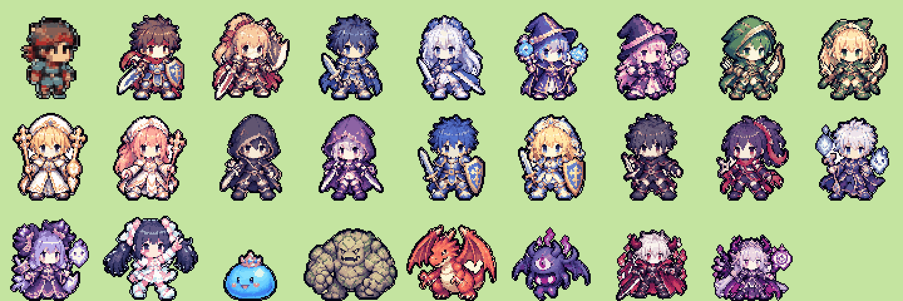

# sprite-pipeline

ChatGPT の画像生成で作った「ドット絵風」の画像を、アプリで使えるスプライト（**立ち姿の静止画1枚**・80×80px・16色・背景透過）に**自動で**整形するスクリプトです。ドット絵エディタでの手作業は不要です。

キャラの外見定義は `.claude/skills/pixel-art-character/references/characters.md` が正です。

> v0.7 で歩行アニメーションをやめて静止画1枚にし、v0.8 で新デザインの25体（80×80px）に入れ替えました。旧素材は `art/archive/` に保管しています（アプリでは使いません）。

## 素材づくりの流れ

1. ChatGPT でキャラ画像を生成してもらう（**1枚に多数のキャラを並べて**頼める。名前札つきの一覧シートでも変換できます）
2. 生成画像をチャットに貼る（Claude Code が `art/source/` に保存する）
3. スクリプトを実行し、確認用の画像で見た目を確認
4. 気に入らないキャラだけ生成し直す
5. `art/sprites/` に置き、`python3 scripts/sync_sprites.py` で Xcode のアセットカタログに同期する

スクリプトの実行は Claude Code 側で行うため、ユーザーの作業は「生成して貼る」「確認画像を見て OK か判断する」だけです。

## スクリプトの処理

1. 背景の除去（画像の外周から背景色を判定。キャラ内部の白は残す）
2. キャラごとの自動切り出し。名前札つきの一覧シートは `--sheet` で、名札を除いて行ごと・左から順に検出し、隣のキャラの絵が入り込んでいたら消す
3. **元画像の「1ドットの大きさ」を自動検出**（複数キャラのときは全キャラの中央値で共通にし、ドット密度をそろえる）し、本来のドット数の本物のピクセルに戻す
4. 共通パレットで 15色に減色（各ドットの中心付近の色を採用し、にじみを拾わない）
5. 濃色1色の輪郭線を付与（輪郭色を含めて16色）
6. 80×80 のキャンバス中央・足元をそろえて配置
7. `{名前}.png` を出力

## 実行方法

```bash
# 名前札つきの一覧シート（現行の素材 cast_sheet_v2 の変換例。名前は左上から行ごとに左→右の順）
python3 -I tools/sprite-pipeline/build_sprites.py art/source/cast_sheet_v2.png \
  --names warrior_m,warrior_f,swordsman_m,swordsman_f,mage_m,mage_f,archer_m,archer_f,priest_m,priest_f,thief_m,thief_f,knight_m,knight_f,ninja_m,ninja_f,summoner_m,summoner_f,superstar,slime,golem,dragon,ghost,demonlord_m,demonlord_f \
  --static --sheet --size 80 --body 78 --tolerance 60 --out /tmp/cast

# 1行に並んだ立ち姿の画像
python3 -I tools/sprite-pipeline/build_sprites.py art/source/new_chars.png \
  --names a,b,c --static --size 80 --body 78 --out /tmp/new
```

- 出力: `{名前}.png` と `preview_sheet.png`（確認画像）。確認してから `{名前}.png` だけを `art/sprites/` にコピーします。
- 実行時に「全キャラ共通の1ドット≒◯px（各キャラの検出値: 最小〜最大）」と表示されます。最小と最大が大きく離れているキャラがあれば、そのキャラだけ密度が違うので再生成をおすすめします。
- 縁に背景色のにじみが残る場合は `--tolerance` を上げ、キャラの一部が消える場合は下げます。
- シートの一部だけを使う場合は `--crop x0,y0,x1,y1`、名前札など低い領域を除く高さは `--min-height`（既定80）で調整します。
- `--walk-frames`（歩行4ポーズ）や `--static` なしの歩行フレーム自動生成も残してありますが、現行の仕様では使いません。

## ChatGPT 用プロンプト

### 1. キャラ一覧（まとめて作る）

最初は、新デザインの一覧シート（`art/source/cast_sheet_v2.png`）を添付して頼むと、絵柄とドットの細かさがそろいます。

```
添付画像と同じ絵柄・同じドットの細かさ・同じ頭身で、次のキャラクターを描いてください。
- {キャラ1の名前}：{外見}
- {キャラ2の名前}：{外見}
...
- ほぼ正面向きの立ち姿の全身像、2頭身のデフォルメ
- 全員で1ドットの大きさを同じにする。アンチエイリアスなし、グラデーションなし、ベタ塗り、濃い色の輪郭線
- キャラ同士は重ならないように十分な間隔をあけ、行ごとに等間隔で並べる。名前札（ラベル）は各キャラの真下に付けてよい
- 背景は無地の白（または単色）。影や地面は描かない
- 既存のゲームやアニメのキャラクターに似せない完全オリジナルデザイン
```

### 2. 1体だけ作り直す

```
添付画像と同じ絵柄・同じドットの細かさ・同じ頭身で、「{名前}」を立ち姿で1体だけ描いてください。
外見：{外見}
背景は無地の白。アンチエイリアスなし、ベタ塗り、濃い色の輪郭線。
```

### 3. 勇者（新デザイン・未作成）

```
添付画像（キャラ一覧）と同じ絵柄・同じドットの細かさ・同じ頭身で、主人公の「勇者」を立ち姿で1体だけ描いてください。
外見：茶色の短髪、赤いハチマキ、青緑のチュニック、短い赤いマント、腰に剣（盾は持たない）。
一覧の「戦士（男）」（赤いハチマキ・青い鎧・盾）とは別人に見えるデザインにする。
背景は無地の白。アンチエイリアスなし、ベタ塗り、濃い色の輪郭線。
```

## 注意

- 背景を無地にすると背景除去が安定します。
- 生成に使ったプロンプトと元画像は `docs/assets-log/` に記録してください（App Store 公開時の権利確認のため）。

## 結果（現行の素材）

新デザインの25体と、仮の勇者（左上）。


