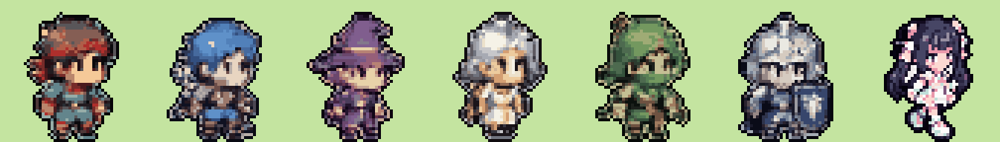

# sprite-pipeline

ChatGPT の画像生成で作った「ドット絵風」の画像を、アプリで使えるスプライト（**立ち姿の静止画1枚**・48×48px・16色・背景透過）に**自動で**整形するスクリプトです。ドット絵エディタでの手作業は不要です。

キャラの外見定義は `.claude/skills/pixel-art-character/references/characters.md` が正です。プロンプトを変えるときはそちらと合わせてください。

> v0.7 で歩行アニメーションをやめ、静止画1枚にしました。過去の歩行4コマは `art/archive/walk-v1/` に保管しています（アプリでは使いません）。

## 素材づくりの流れ

1. 下のプロンプトで ChatGPT にキャラ画像を生成してもらう（**1枚に5〜7体を横に並べて**頼める）
2. 生成画像をチャットに貼る（Claude Code が `art/source/` に保存する）
3. スクリプトを実行し、`preview_sheet.png` を見て確認
4. 気に入らないキャラだけ生成し直す
5. `python3 scripts/sync_sprites.py` で Xcode のアセットカタログに同期する

スクリプトの実行は Claude Code 側で行うため、ユーザーの作業は「生成して貼る」「プレビューを見て OK か判断する」だけです。

## スクリプトの処理

1. 背景の除去（画像の外周から背景色を判定。キャラ内部の白は残す）
2. キャラごとの自動切り出し（左から順に `--names` の名前を付ける）
3. **元画像の「1ドットの大きさ」を自動検出**し、本来のドット数の本物のピクセルに戻す（grid）。検出できない・キャンバスに収まらない場合は縮小（fit）
4. 共通パレットで 15色に減色（各ドットの中心付近の色を採用し、にじみを拾わない）
5. 濃色1色の輪郭線を付与（輪郭色を含めて16色）
6. 48×48 のキャンバス中央・足元をそろえて配置
7. `{名前}.png` を出力

## 実行方法

```bash
# 立ち姿のキャラが横に並んだ画像（現行の方法）
python3 -I tools/sprite-pipeline/build_sprites.py art/source/party_v2.png \
  --names archer,monk,dancer,alchemist,ninja,bard,pirate --static --out art/sprites
```

- 出力: `{名前}.png`（`art/sprites/` に直接置く）と `preview_sheet.png`（全員を草原色の背景に横一列に並べた確認画像。確認後は `art/sprites/` から消すか、別のフォルダに出力する）
- 実行時に「1ドット≒◯px と検出」と表示されます。**全キャラでこの値がほぼ同じ（＝ドット密度がそろっている）こと**を確認してください。1体だけ「fit」になった場合は密度がずれているので、再生成をおすすめします。
- 縁に背景色のにじみが残る場合は `--tolerance` を上げ、キャラの一部が消える場合は下げます。
- シートの一部だけを使う場合は `--crop x0,y0,x1,y1` で範囲を指定します。
- `--walk-frames`（歩行4ポーズ）や、`--static` なしの歩行フレーム自動生成も残してありますが、現行の仕様では使いません。

## ChatGPT 用プロンプト

### 1. 立ち姿のキャラ一覧（まとめて作る）

```
オリジナルのレトロRPG風ドット絵キャラクターを、横一列に等間隔で並べてください。
- 左から順に：
  1. {キャラ1の外見}
  2. {キャラ2の外見}
  ...
- 全員、同じ向きで立っている全身像の「立ち姿」1枚ずつ。2頭身のデフォルメ
- 縦40ドット前後に見える、粗いドットのピクセルアート（全員で1ドットの大きさを同じにする）
- アンチエイリアスなし、グラデーションなし、ベタ塗り、濃い色の輪郭線
- キャラ同士は重ならないように十分な間隔をあける
- 背景は無地のマゼンタ（#FF00FF）一色。影や地面は描かない
- 既存のゲームやアニメのキャラクターに似せない完全オリジナルデザイン
- 光るエフェクトは使わない
```

2回目以降は、既存キャラの画像（例: `art/sprites/swordsman.png`）を添付し、「添付画像と同じ絵柄・同じドットの細かさ・同じ頭身で」と加えると、全キャラの密度がそろいます。

### 2. 1体だけ作り直す

```
添付画像と同じ絵柄・同じドットの細かさ・同じ頭身で、「{職業}」を立ち姿で1体だけ描いてください。
外見：{外見}
背景は無地のマゼンタ（#FF00FF）一色。アンチエイリアスなし、ベタ塗り、濃い色の輪郭線。
```

### 外見（コピー用）

| キャラ | 外見 |
|---|---|
| 勇者 | 茶色の短髪に赤いハチマキ、青緑のチュニック、短い赤マント、腰に剣 |
| 剣士 | 青いツンツン髪、革の胸当て、背中に大きな剣 |
| 魔法使い | 紫のとんがり帽子（金の帯）、紫のローブ、宝玉の杖 |
| 僧侶 | 銀髪、金の縁取りの白い法衣、先が輪になった杖 |
| 盗賊 | 口元まで覆う緑の頭巾、緑の軽装、腰に短剣 |
| 騎士 | 銀の兜と鎧、紺のサーコート、大きな紺の盾 |
| スーパースター | 黒髪のロングツインテールにピンクとミントの大きなリボン、はっきりしたピンクと白のアイドル風ドレス、厚底ブーツ |
| 弓使い（候補） | 橙のポニーテール、羽根付きの帽子、茶色の革鎧、背中に矢筒、短弓 |
| 武闘家（候補） | 白いハチマキ、道着、手甲、素手で構える |
| 踊り子（候補） | 口元のベール、ひらひらした衣装、アクセサリー |
| 錬金術師（候補） | 額にゴーグル、白衣、フラスコ |
| 忍者（候補） | 黒装束、長いマフラー、背中に小刀 |
| 吟遊詩人（候補） | 羽根付きの帽子、派手な上着、リュート |
| 海賊（候補） | 眼帯、三角帽子、片手に短剣 |

## 注意

- 背景を無地にすると背景除去が安定します。
- 生成に使ったプロンプトと元画像は `docs/assets-log/` に記録してください（App Store 公開時の権利確認のため）。

## 結果（v1 素材）

現行の静止画 7 体（`art/sprites/*.png`）を横に並べたもの。


