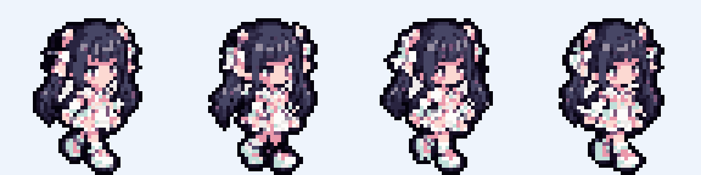
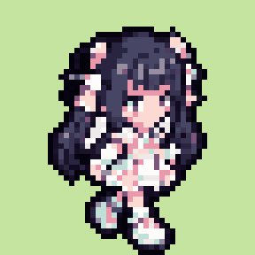
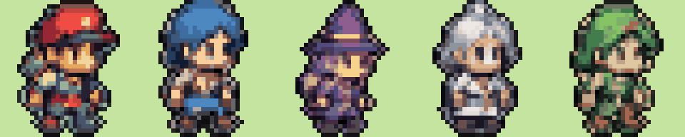

# sprite-pipeline

ChatGPT の画像生成で作った「ドット絵風」の画像を、アプリで使えるスプライト（48×48px・16色・背景透過・歩行4フレーム）に**自動で**整形するスクリプトです。ドット絵エディタでの手作業は不要です。

キャラの外見定義は `.claude/skills/pixel-art-character/references/characters.md` が正です。プロンプトを変えるときはそちらと合わせてください。

## 素材づくりの流れ

1. 下のプロンプトで ChatGPT にキャラ画像を生成してもらう（**1キャラ1枚、歩行4ポーズを横に並べる**のがおすすめ）
2. 生成画像をチャットに貼る（Claude Code が `art/source/` に保存する）
3. スクリプトを実行し、`preview_sheet.png` と `preview_walk.gif` を見て確認
4. 気に入らないキャラだけ生成し直す

スクリプトの実行は Claude Code 側で行うため、ユーザーの作業は「生成して貼る」「プレビューを見て OK か判断する」だけです。

## スクリプトの処理

1. 背景の除去（画像の外周から背景色を判定。キャラ内部の白は残す）
2. キャラ（またはポーズ）ごとの自動切り出し
3. **元画像の「1ドットの大きさ」を自動検出**し、本来のドット数の本物のピクセルに戻す（grid）。検出できない・キャンバスに収まらない場合は縮小（fit）
4. 共通パレットで 15色に減色（各ドットの中心付近の色を採用し、にじみを拾わない）
5. 濃色1色の輪郭線を付与（輪郭色を含めて16色）
6. 48×48 のキャンバス中央・足元をそろえて配置
7. 歩行4フレームの出力（4ポーズの画像ならそのまま、直立1枚なら自動生成）

## 実行方法

```bash
# 1キャラの歩行4ポーズが並んだ画像（推奨）
python3 -I tools/sprite-pipeline/build_sprites.py art/source/superstar_walk_v1.png \
  --names superstar --walk-frames --out art/sprites/superstar

# 直立の複数キャラが並んだ画像（歩行フレームは自動生成）
python3 -I tools/sprite-pipeline/build_sprites.py art/source/party_v1.png \
  --names hero,swordsman,mage,priest,thief,knight --out art/sprites/party
```

- 出力: `{名前}_right_{0..3}.png`、`preview_sheet.png`、`preview_walk.gif`
- 実行時に「1ドット≒◯px と検出」と表示されます。**全キャラでこの値がほぼ同じ（＝ドット密度がそろっている）こと**を確認してください。1体だけ「fit」になった場合は密度がずれているので、再生成をおすすめします。
- 縁に背景色のにじみが残る場合は `--tolerance` を上げ、キャラの一部が消える場合は下げます。

## ChatGPT 用プロンプト

### 1. 歩行4ポーズ（1キャラずつ・推奨）

```
オリジナルのレトロRPG風ドット絵キャラクター「{職業}」の歩行アニメーションを描いてください。
- 外見：{下の表の外見}
- 右向きに歩く4ポーズを、左から順に横一列に等間隔で並べる（歩行の1サイクル）
- 4ポーズとも同じ大きさ・同じ顔・同じ服で、足の位置だけが変わる
- 2頭身のデフォルメ全身像。縦40ドット前後に見える、粗いドットのピクセルアート
- アンチエイリアスなし、グラデーションなし、ベタ塗り、濃い色の輪郭線
- ポーズ同士は重ならないように十分な間隔をあける
- 背景は無地の単色（マゼンタ #FF00FF 推奨。淡い灰色でも可）。影や地面は描かない
- 既存のゲームやアニメのキャラクターに似せない完全オリジナルデザイン
- 光るエフェクトは使わない
```

2体目以降は、完成済みのキャラ画像（例: スーパースター v1）を添付し、「添付画像と同じ絵柄・同じドットの細かさで」と加えると密度がそろいます。

| キャラ | 外見 |
|---|---|
| 勇者 | 茶色の短髪に赤いハチマキ、青緑のチュニック、短い赤マント、腰に剣 |
| 剣士 | 青いツンツン髪、革の胸当て、背中に大きな剣 |
| 魔法使い | 紫のとんがり帽子（金の帯）、紫のローブ、宝玉の杖 |
| 僧侶 | 銀髪、金の縁取りの白い法衣、先が輪になった杖 |
| 盗賊 | 口元まで覆う緑の頭巾、緑の軽装、腰に短剣 |
| 騎士 | 銀の兜と鎧、紺のサーコート、大きな紺の盾 |
| スーパースター | 黒髪のロングツインテールにピンクとミントの大きなリボン、はっきりしたピンクと白のアイドル風ドレス、厚底ブーツ（v1 作成済み） |

### 2. 直立のキャラ一覧（絵柄の比較用）

```
オリジナルのレトロRPG風ドット絵キャラクターを、外見定義の順に横一列に等間隔で並べてください。
全員「右向き」で立っている全身像、2頭身のデフォルメ、縦40ドット前後に見えるピクセルアート。
アンチエイリアスなし、ベタ塗り、濃い色の輪郭線、背景は無地のマゼンタ（#FF00FF）一色。
既存のゲームやアニメのキャラクターに似せない完全オリジナルデザイン。
```

## 注意

- 背景を無地にすると背景除去が安定します。
- 生成に使ったプロンプトと元画像は `docs/assets-log/` に記録してください（App Store 公開時の権利確認のため）。

## 結果

### スーパースター v1（本素材）

GPT が描いた歩行4ポーズをそのまま取り込んだ結果。1ドット≒10.75px を検出し、縦41ドットのまま変換。




### 試作（画面イメージから）

画面イメージ（`docs/images/concept-v1.png`）の「仲間たち」欄から5体を変換した結果。元画像が小さく正面向きのため、ドット格子を検出できず縮小（fit）になっています。



